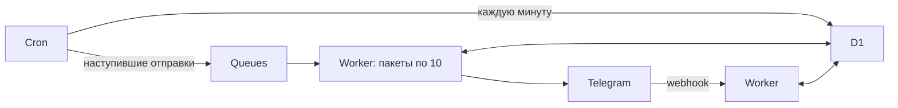

# Высшая школа геншина — Telegram-бот

Мероприятия, значимые посты, задания организаторам, расписание, напоминания и предложка. Интерфейс на русском, целиком в Telegram: кнопки, пошаговые формы и пересылка постов. Две роли: участник и организатор; все орги могут редактировать всё.

[Короткая техспека](docs/TECH_SPEC.md) · [Инструкция организатора](docs/ORGANIZERS.md)

## Что уже реализовано

- Публичное и внутреннее расписание по месяцам, идеи без даты.
- Создание и редактирование мероприятий и постов; отдельная публикация карточки в расписании.
- Несколько ответственных по известным боту @никам, задачи и подзадачи, статус выполнения, необязательный дедлайн.
- Орг-напоминания за 168/72/24 часа в личку и тему беседы оргов одновременно.
- Напоминания за 72/24 часа до окончания внешней регистрации, привязанные к основному посту: в подписавшиеся лички и группы, куда добавлен бот. Каналы и беседа оргов исключены.
- Предложения с текстом/медиа в отдельную тему беседы оргов.
- Сохранение незаконченных форм, очередь отправок, повторные попытки, защита от повторной обработки, проверка актуальной роли перед доставкой внутренних ответов.

## Что потребуется

1. Аккаунт [Cloudflare Free](https://dash.cloudflare.com/sign-up). ВМ, домен, Supabase, OpenAI API и Telegram Stars не нужны.
2. Новый бот у [@BotFather](https://t.me/BotFather): `/newbot`. Токен вводится скрыто локальным помощником; не присылайте его в чат и не добавляйте в GitHub.
3. Node.js 24 и pnpm 11.25.0. На машине с Corepack: `corepack enable`, затем `corepack prepare pnpm@11.25.0 --activate`.
4. Беседа оргов с темами «Напоминания» и «Предложения» (или два отдельных чата). Бот должен иметь возможность отправлять сообщения в эти темы. Управление темами и чтение всей переписки ему не требуются.

## Установка и запуск

```sh
git clone https://github.com/Sarkibartierbitti/hse-genshin-bot.git
cd hse-genshin-bot
pnpm install --frozen-lockfile
pnpm setup
pnpm cloudflare:setup
```

`pnpm setup` проверяет токен через Telegram и сохраняет его в `.dev.vars` с правами `0600`. Первых оргов можно задать ID через запятую. Если ID неизвестен, помощник предложит отправить `/start` новому боту и определит отправителя до подключения webhook. На этом этапе бот ещё не отвечает — это ожидаемо.

`pnpm cloudflare:setup` открывает официальный OAuth-вход Cloudflare, создаёт D1 и очередь, применяет миграции, развёртывает Worker и передаёт секреты через stdin в Cloudflare Secrets. В конце подключает webhook после подтверждения в терминале. Сценарий не включает платный тариф. ID созданной базы записывается в `wrangler.jsonc`; его стоит сохранить в Git после успешного запуска.

Если в аккаунте уже есть база с таким именем, помощник остановится. Укажите её ID вручную только если это база именно данного бота, либо измените `database_name`. При нескольких аккаунтах Cloudflare укажите `CLOUDFLARE_ACCOUNT_ID` в окружении Wrangler.

После подключения:

1. Отправьте `/start` боту в личку. Первые ID из настройки получают роль орга; бот покажет соответствующие кнопки.
2. Добавьте бота в беседу оргов. В теме напоминаний отправьте `/orgchat`, в теме предложений — `/suggestionschat`. Команды выполняет орг. Обе темы могут быть в одной беседе.
3. Добавьте бота в публичные группы. Он отслеживает добавление/удаление автоматически. В любой теме беседы оргов доступны меню и формы; ответы приходят в ту же тему. В публичных группах доступно публичное меню. Команды можно адресовать явно: `/start@имя_бота`, `/suggest@имя_бота`.
4. Участники открывают личку и включают подписку. Подписка одна — на все публичные события.

Первые организаторы задаются `BOOTSTRAP_ORG_IDS`. Их нельзя разжаловать через меню, пока ID остаётся в конфигурации. Остальные роли меняются кнопкой «Организаторы». Третьей роли нет.

Форма привязана к исходному чату и теме. Обычная переписка в других темах её не продолжает. Бот не пересылает всю переписку группы: предложение отправляется только после явного вызова предложки. В группе с включённым Privacy Mode текстовое поле заполняется ответом на сообщение бота; администратор-бот получает сообщения во всех темах.

## Локальная разработка

```sh
pnpm db:migrate:local
pnpm dev
```

Состояние локальной D1 сохраняется в `.wrangler/`; оно не попадает в Git и не переносится в прод автоматически. Webhook Telegram требует публичный HTTPS-адрес. Локальный сервер сам по себе не получает сообщения Telegram; автоматические тесты работают без токена и сети.

```sh
pnpm check
pnpm build
```

Тесты используют настоящий SQLite с миграциями и подставной Telegram API. Проверяются формы, приватность, роли, повторные обновления, даты, очередь, 500 получателей, обработка 429 и восстановление после сбоев. Отдельно применяется миграция в настоящем локальном D1 через Wrangler. `build` собирает Worker без публикации.

## Архитектура



Все времена — UTC в миллисекундах; ввод и показ — Москва. Интервалы считаются точно от времени события/дедлайна. Фактическая доставка зависит от cron, очереди и Telegram, без гарантии до секунды.

Формы живут 24 часа. Задания без собственного дедлайна наследуют дату мероприятия или планируемой публикации. Завершение родительского мероприятия отключает связанные напоминания. Регистрация проходит вне бота: известен её срок, но неизвестно, кто уже зарегистрирован.

Уведомления сохраняются до передачи в очередь. Повторы Queues не создают повторную отправку после зафиксированного успеха. Между успешным ответом Telegram и сохранением результата остаётся небольшой риск дубля: у `sendMessage` нет ключа идемпотентности. Необработанные API-ошибки и токены в логи не выводятся.

## Бесплатные квоты и эксплуатация

На момент разработки Workers Free включает 100 000 запросов/день и 10 мс CPU на запуск, D1 — 5 млн прочитанных и 100 000 записанных строк/день, до 500 МБ на одну базу; Queues — 10 000 операций/день. Одна успешная доставка через Queues обычно занимает три операции, поэтому это примерно 3 333 сообщения в сутки без учёта повторов и других очередей аккаунта. [Workers](https://developers.cloudflare.com/workers/platform/pricing/), [D1](https://developers.cloudflare.com/d1/platform/limits/), [Queues](https://developers.cloudflare.com/queues/platform/pricing/).

Бесплатный тариф не является обещанием неограниченной нагрузки. Следите за CPU, чтениями D1, длиной очереди и failed-уведомлениями в Cloudflare. Будущие уведомления материализуются по 36 за проход cron; карточки лучше настраивать заранее. При многотысячных аудиториях или большом числе одновременных мероприятий понадобится пересмотр квот и генерации расписания.

Обновление кода после первичного запуска:

```sh
pnpm check
pnpm build
pnpm db:migrate:remote
pnpm deploy
```

Замена токена/секретов: измените локальный `.dev.vars`, затем запустите `pnpm cloudflare:setup` и переподключите webhook. Секреты не размещаются в `wrangler.jsonc` и GitHub. Для проверки webhook: `pnpm webhook https://имя-воркера.поддомен.workers.dev`.

Миграции используют версионированные SQL-файлы в `migrations/`. Не удаляйте удалённую D1 при обычном обновлении. Перед изменениями данных сделайте экспорт командой `pnpm exec wrangler d1 export DB --remote --output backup.sql` и храните резервную копию вне репозитория.
